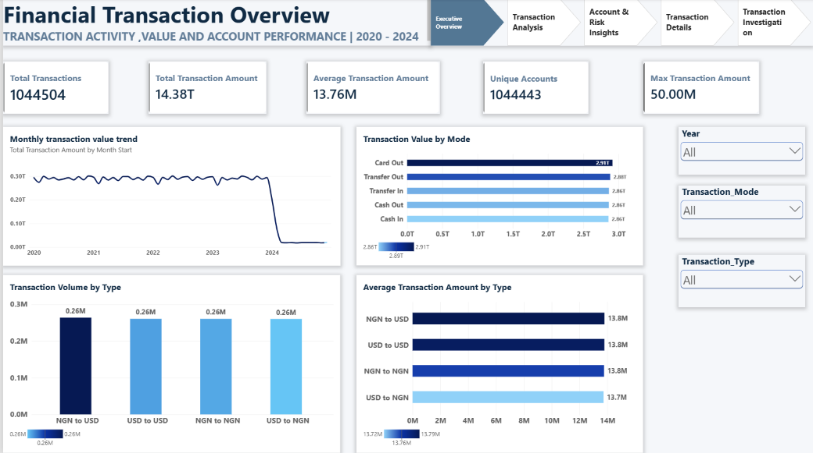
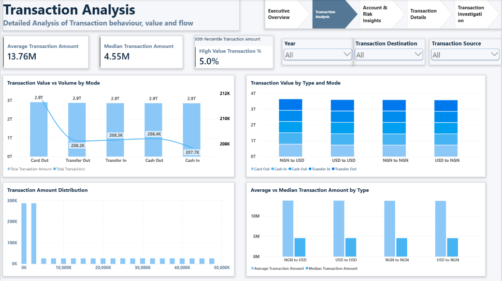
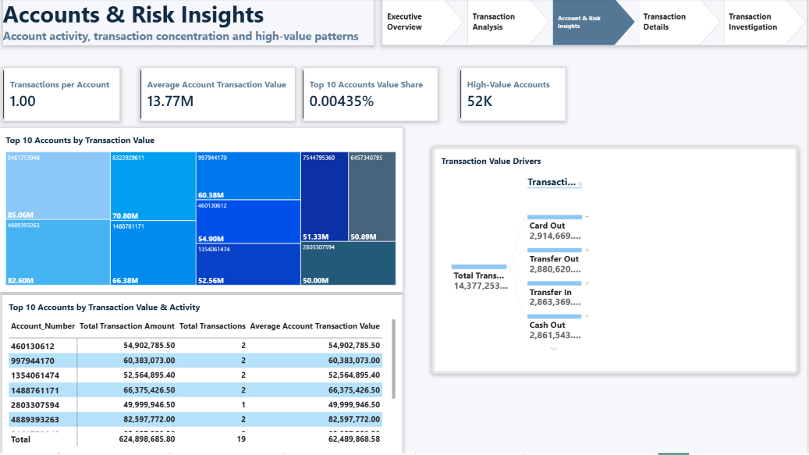
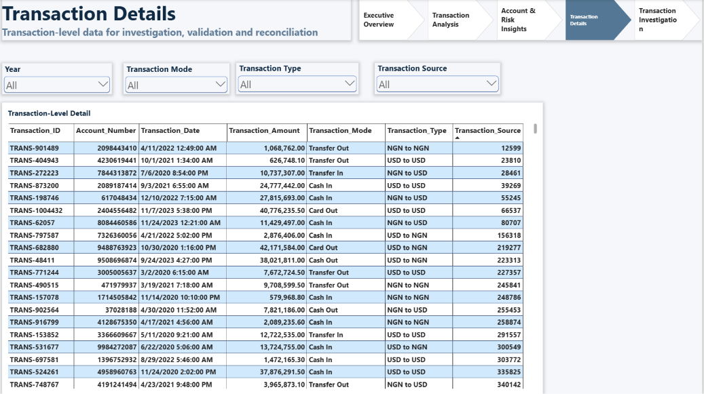
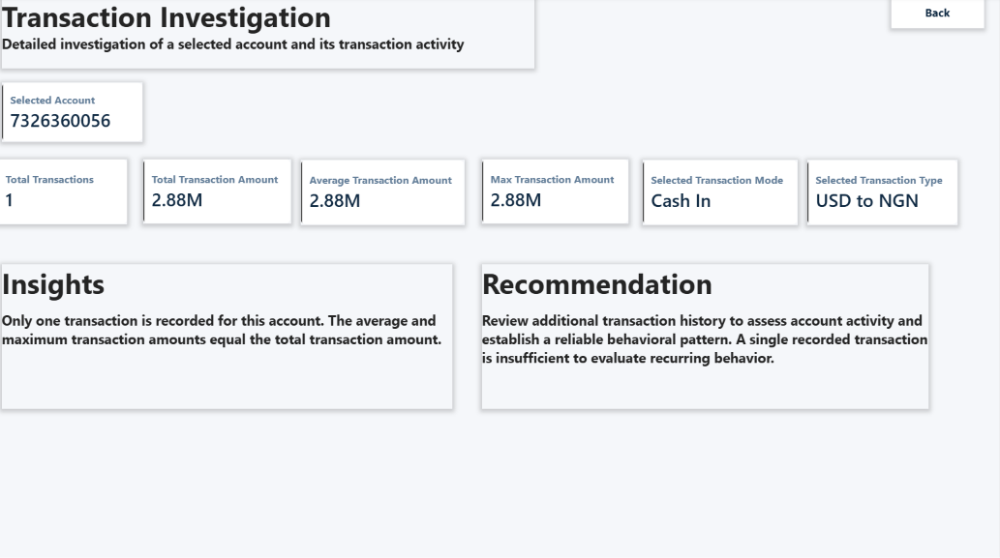

# 💰 Financial Transaction Analytics & KPI Dashboard

An interactive financial transaction analytics dashboard developed using Microsoft Power BI to analyze transaction activity, transaction methods, transaction types, trends, and key financial KPIs.

## 📊 Project Overview

This project analyzes a large financial transaction dataset containing more than 1 million transaction records.

The objective is to clean, validate, transform, and analyze transaction data and present meaningful business insights through an interactive Power BI dashboard.

## 🎯 Business Problem

Financial transaction data can contain millions of records, making it difficult for business and finance teams to quickly understand transaction activity, value concentration, transaction methods, and account-level behavior.

The objective of this project is to develop an interactive Power BI dashboard that helps financial teams:

- Monitor transaction volume and transaction value trends.
- Compare transaction activity across transaction methods and transaction types.
- Identify high-value transactions and accounts.
- Analyze account-level transaction behavior.
- Investigate individual transactions for validation and reconciliation.
- Improve financial reporting and support data-driven decision-making.

## 🛠️ Tools & Technologies

- Microsoft Power BI
- Power Query
- Microsoft Excel
- Data Cleaning
- Data Validation
- Data Transformation
- Data Visualization
- KPI Analysis

## 📁 Dataset

The dataset contains financial transaction records with fields including:

- Transaction ID
- Account Number
- Account Name
- Transaction Amount
- Transaction Mode
- Transaction Type
- Transaction Date
- Transaction Source
- Transaction Destination

## 🧹 Data Preparation

The dataset was processed using Excel and Power Query.

Key data preparation activities included:

- Duplicate identification and removal
- Missing-value validation
- Transaction date validation
- Data type standardization
- Date/time transformation
- Data profiling
- Transaction data quality checks
- Power Query transformation

## 📈 Dashboard Analysis

The dashboard provides analysis of:

- Transaction volume
- Transaction value
- Transaction methods
- Transaction types
- Transaction trends
- Transaction sources
- Transaction activity over time

## 🔎 Key Insights

The dashboard analysis identified the following key findings:

1. **High transaction volume** – The dataset contains **1,044,504 transactions**, providing a large-scale view of financial transaction activity.

2. **Significant transaction value** – The total transaction amount is approximately **14.38 trillion**, with an average transaction amount of approximately **13.76 million**.

3. **Transaction methods are relatively balanced** – Card Out, Transfer Out, Transfer In, Cash Out, and Cash In each contribute approximately **2.86–2.91 trillion** in transaction value.

4. **Transaction types have similar volumes** – NGN to USD, USD to USD, NGN to NGN, and USD to NGN each account for approximately **0.26 million transactions**, indicating a relatively balanced transaction mix.

5. **Limited account concentration** – The top 10 accounts contribute only a very small percentage of overall transaction value, indicating that transaction value is not heavily concentrated among a small number of accounts.

6. **High-value transaction monitoring is important** – The dashboard identifies approximately **52K high-value accounts**, providing an opportunity for additional monitoring and risk analysis.

7. **Transaction-level investigation supports validation** – The transaction details and investigation pages allow users to drill into individual accounts and transactions for reconciliation and behavioral analysis.
   
## 💡 Business Recommendations

Based on the dashboard findings:

1. **Monitor high-value accounts**
   
   Financial teams should regularly review high-value accounts and transactions to identify unusual activity and potential financial risks.

2. **Investigate transaction trends**
   
   Monitor transaction value and volume over time to identify significant changes that may require further investigation.

3. **Strengthen transaction monitoring**
   
   Establish appropriate thresholds for high-value transactions and investigate transactions that exceed expected patterns.

4. **Analyze account behavior**
   
   Use account-level transaction history to distinguish normal activity from unusual or potentially risky behavior.

5. **Improve financial reporting**
   
   Use automated Power BI reporting to provide finance teams with consistent and interactive transaction KPIs.

6. **Support reconciliation and investigation**
   
   Use the transaction-level detail page to validate individual transactions and support financial reconciliation processes.

7. **Maintain data quality**
   
   Continue using Power Query-based cleaning and validation processes to improve the reliability and accuracy of financial reporting.

## 📸 Dashboard Preview

### Financial Transaction Overview

### Transaction Analysis

### Transaction Trends

### Transaction Methods

### Transaction Insights

## 👩‍💻 Skills Demonstrated

- Data analysis
- Data cleaning
- Data validation
- Data transformation
- Power Query
- Power BI
- KPI development
- Data visualization
- Business analysis
